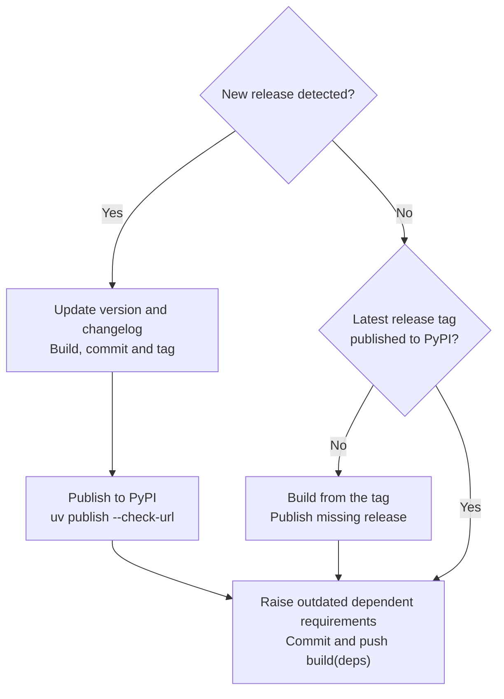

# Development

## Development instructions

Check [component](./components) related instructions in each component's README.md.

Detailed documentation of the raster data processing: the pipeline architecture, parallel DEM ingestion with staging tables, and dissolving update areas into the preview DEM can be found in the [processing component's README](components/processing/README.md).

## Development environment

* Copy .env.example to .env and adjust settings
* Open project in devcontainer, see [instructions](.devcontainer/README.md)
* Optional: save LASTools license as ./external/LAStools/lastoolslicense.txt
* Activate virtual environment: `source .venv/bin/activate`
* Create a `.env` from `.env.example` and fill empty values and modify configurations if necessary
* Start the containers downloaded from GitHub container registry: `make restart-fully`

Alternatively, you can build the containers from scratch:

* Build all containers: `make build`
* Start the containers: `make up`

Now all development tools and Git hooks are automatically installed in your virtual environment when using Dev
Containers.

### Developing individual components

This project uses [uv workspaces](https://docs.astral.sh/uv/concepts/projects/workspaces/) and shares just one python
virtual environment
and one single uv.lock file across all components. When developing individual components, go to the component directory
and run `make sync` to synchronize dependencies. Alternatively you can sync component dependencies in root using
`uv sync --package <component-package>`. If component happens to have extras that you want, just add `--all-extras` to
sync command. This will install all the dependencies component's dependencies into venv
and at the same time removes all the libraries that are not needed by that individual component.

If you need to have some other component as a dependency, just run `uv add ../component_name` and uv automatically
updates the component's pyproject.toml file.

See the additional instructions for developing individual components in their respective README files.

### Updating dependencies

If you make any changes to some of the pyproject.toml files, synchronize dependencies with

* Synchronize dependencies: `make sync`

If you want to update locked package versions, run:
`uv lock --upgrade`

### Commit messages

Commit messages should follow [Conventional Commits notation](https://www.conventionalcommits.org/en/v1.0.0/#summary).

Commit messages are used by [Python Semantic Release (PSR)](https://python-semantic-release.readthedocs.io)
to generate and update component-specific changelogs. By default, PSR can detect which commits are
related to which component by update file path. However, you can specifically define when the commit is relevant to the
package using commit scope that equals the component directory name:

```shell
git commit -m "fix(db): fix something somewhere not in directly componen's path".
```

To trigger a major release for the component, the commit message body must contain a paragraph that begins with
"BREAKING CHANGE:".

### Imports

Imports should follow the [Google style guide](https://google.github.io/styleguide/pyguide.html#22-imports) except for
classes and airflow sdk. Classes could be imported directly
from the module as well as airflow sdk components.

### Feature flags

This project uses feature flags to support the development of new features.
Declare flags in  [components/lib/src/pinta_common/flags.py](components/lib/src/pinta_common/flags.py) and use them with `if flags.FLAG_X:`.
Outside development mode, every declared flag must exist in the JSON file pointed to by
`PINTA_FEATURE_FLAG_CONFIG`.

See [components/lib/test_lib/data/feature_flags.json](components/lib/test_lib/data/feature_flags.json)
for an up-to-date example.

### Tests and coverage

Run the suites with `make test` (unit) and `make test-integration` (needs the
databases up — `make up`). Both run under `coverage`, writing fragments to the
repo root.

## Release steps

Component releases are automatized with [Python Semantic Release (PSR)](https://python-semantic-release.readthedocs.io).

When the branch is in a releasable state, trigger the `[release.yml](.github/workflows/release.yml)` workflow from
GitHub Actions. Workflow checks which components need releasing automatically based on commits in the repository.
For each component the tag will be created, and a new version to PyPI will be published.

A component is released only if it has `feat` (minor), `fix` or `build` (patch) commits since its last release,
other commit types never trigger a release. Components are released one after another in dependency order
(`lib` → `db` → `processing`, `backend` → `qgis_plugin`, `dags`), so dependencies are published first.

For each component, the shared
[`python-monorepo-release-action`](https://github.com/nlsfi/python-monorepo-release-action) does the following:



The release is safe to rerun. If a run fails halfway (for example, a PyPI trusted publisher is missing for a package),
run the workflow again: already published files are skipped and tagged but unpublished versions are published.

The backend and processing container images are built and pushed after all Python packages have been released.
Use the `dry_run` input to build everything without committing, tagging or publishing.
